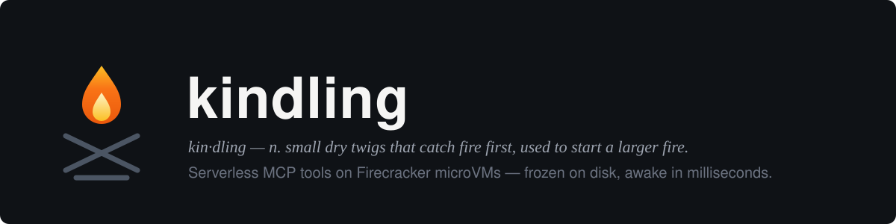

<p align="center">
  
</p>

<p align="center">
  <a href="https://github.com/juan52878911/kindling/releases"></a>
  <a href="https://github.com/juan52878911/kindling/actions/workflows/ci.yml"></a>
  <a href="LICENSE"></a>
</p>

<p align="center"><a href="README.md">English</a> · <b>Español</b></p>

# kindling

**Sandboxes autoalojados para agentes de IA, donde cada sandbox es una microVM de verdad:
se crea en un milisegundo más o menos desde un fondo precalentado, en menos de 100 ms en frío,
y congelado no gasta ni CPU ni RAM. El código escrito para el SDK de OpenSandbox lo usa
cambiando la URL y la clave.**

<!-- TODO(demo): grabar docs/demo.gif en un host con KVM con `vhs docs/demo.tape` y descomentar:
<p align="center"></p>
-->

- **Tu SDK ya lo habla.** `kling sbx osb` sirve la API de OpenSandbox 1.2.1 (ciclo de vida y
  execd): sus SDK crean sandboxes, ejecutan órdenes y código y mueven ficheros cambiando
  `domain` y `api_key`. De las 90 operaciones de la spec hay 41 implementadas; el resto
  (bóveda de credenciales, snapshots, construcción de plantillas, diagnóstico, sesiones
  aisladas) contesta `501` con el motivo ([la lista](docs/opensandbox.md)). La CI recorre el
  shim con el SDK real de Python `opensandbox==1.2.1`. `kling sbx e2b` hace lo mismo con E2B:
  la CI pasa por él los SDK oficiales `e2b` 2.64.0 (Python y JavaScript) y
  `e2b-code-interpreter` 2.11.10, cubriendo ciclo de vida, órdenes, ficheros y `run_code`,
  contra el gateway real sobre un host simulado. PTY, stdin en vivo, vigilancia de ficheros,
  snapshots y construcción de plantillas no están soportados ([docs/e2b.md](docs/e2b.md)).
- **Un hipervisor por sandbox, no un kernel compartido.** Cada sandbox es una microVM de
  Firecracker (en un Mac, Virtualization o Hypervisor framework de Apple) con su propio
  kernel; el invitado se da por hostil ([`SECURITY.md`](SECURITY.md)). Los inquilinos
  comparten host y daemon: un token es un dueño y una cuota, no una máquina aparte.
- **Nada arranca.** Una plantilla se construye una vez en un snapshot dorado. Un sandbox es
  una restauración de ese snapshot, o el reclamo atómico de uno que ya corre en el fondo.
- **Lo ocioso no cuesta.** Cuando vence su TTL, el sandbox se congela en un fichero en disco
  (sin proceso, 0 CPU, 0 RAM) y despierta con la siguiente petición. `pause` conserva su
  memoria; `fork` copia un sandbox vivo, con memoria y procesos, en N.
- **Un daemon en tu máquina.** Un Linux con KVM (amd64 o arm64) o un Mac con Apple Silicon.
  Sin Kubernetes y sin Docker en el host. El daemon escucha solo en un socket Unix; el gateway
  de delante pone tokens, cuotas, plantillas y varios hosts.

**Documentación completa: [kindling.asccilabs.com](https://kindling.asccilabs.com)** ·
en el repo: [`docs/`](docs/README.md), empezando por la [guía completa](docs/guia.md).

## Cifras

kindling contra OpenSandbox 1.2.1 en la misma máquina, un sistema cada vez, con el mismo
cliente (`scripts/bench/`). Los rangos son entre 3 rondas.

| medida | kindling | OpenSandbox 1.2.1 |
|---|---|---|
| crear desde el fondo, en serie (n=15) | **0,8–1,1 ms** | 34 ms (`Pool` de k8s) |
| crear en frío, en serie (n=15) | **76–91 ms** | 0,91–1,11 s (k8s) · 524–543 ms (docker) |
| crear en frío, 50 a la vez | **p50 603–633 ms, p95 977–1072 ms** | 4,0–4,6 s, 19/50 fallidas (k8s) · 7,6–7,7 s (docker) |
| exec `echo` por el gateway (n=30) | **1,7–1,9 ms** | sin comparar: medimos ~1 s y no sabemos por qué (OpenSandbox documenta ~203 ms) |
| creaciones fallidas | **0 de ~1700** | 19/50 (k8s, frío c50) · 25/50 (`Pool` de k8s, c50) |

Las salvedades, en una línea: virtualización anidada en una sola EC2 c8i.2xlarge (8 vCPU), n
pequeño, medido el 2026-11-21; microVMs contra los contenedores (runc) de OpenSandbox con sus
runtimes de Kubernetes (k3s) y Docker, **no** contra OpenSandbox con Kata o gVisor, que no se
midió; los dos «fondos» no son lo mismo (10 microVMs ya arrancadas frente a un CRD `Pool` de
pods); y OpenSandbox va por delante en bóveda de credenciales, diagnóstico, CRD nativos de
Kubernetes y número de SDK. Las nueve salvedades y cómo reproducirlo:
[`docs/benchmarks.md`](docs/benchmarks.md#kindling-vs-opensandbox-121) (en inglés).

## De cero a un agente ejecutando código

En un Linux con KVM. El único paso lento es construir la imagen `toolchain`, una vez; a partir
de ahí cada sandbox sale de un snapshot.

```sh
# kindling, la extensión sandbox y el daemon (firecracker, jailer, unidad de systemd)
curl -fsSL https://raw.githubusercontent.com/juan52878911/kindling/main/scripts/install.sh | sudo sh -s -- --tag v1.0.0-rc.3 --with sandbox
sudo kling up -install
kling image toolchain                    # Node, npm, Python 3 y pip

# un token (un token es un inquilino) y el gateway delante del daemon
export KLING_SANDBOX_TOKEN=$(openssl rand -hex 24)
kling sbx gateway &                      # http://127.0.0.1:8090; HTTP sin TLS solo en loopback

# una plantilla: se construye una vez en un snapshot dorado, con un sandbox caliente en el fondo
curl -fsSL https://raw.githubusercontent.com/juan52878911/kindling/main/examples/sandbox/templates/python.json | kling sbx template apply -f -

kling sbx new -template python -ttl 10m  # imprime el id y cuánto tardó
kling sbx exec <id> -- python3 -c 'print(6*7)'
```

**Desde Python, con el SDK de kindling** (solo biblioteca estándar; aún no está en PyPI):

```sh
pip install "git+https://github.com/juan52878911/kindling#subdirectory=sdks/python"
```

```python
from kindling_sandbox import Sandbox      # lee KLING_SANDBOX_URL y KLING_SANDBOX_TOKEN

with Sandbox.create(template="python", ttl=600) as sb:     # se borra al salir
    print(sb.exec(["python3", "-c", "print(6*7)"]).stdout)
```

**Desde código escrito para OpenSandbox**, sin tocar más que la conexión:

```sh
pip install opensandbox==1.2.1
kling sbx osb -default-template python & # API de OpenSandbox en 127.0.0.1:8080; toda imagen corre en "python"
```

```python
import os
from datetime import timedelta
from opensandbox.config.connection_sync import ConnectionConfigSync
from opensandbox.sync.sandbox import SandboxSync

cfg = ConnectionConfigSync(domain="http://127.0.0.1:8080", api_key=os.environ["KLING_SANDBOX_TOKEN"])
sb = SandboxSync.create("python:3.12", connection_config=cfg, timeout=timedelta(minutes=10))
print(sb.commands.run("python3 -c 'print(6*7)'").logs.stdout[0].text)
sb.kill()
```

OpenSandbox arranca contenedores desde una imagen; kindling arranca microVMs desde una
plantilla, así que el shim traduce una a otra (`-image-map python:3.12=python`, repetible, o
`-default-template`). Además: el SDK de TypeScript ([`sdks/typescript`](sdks/typescript/README.md)),
los SDK de E2B y `e2b-code-interpreter` con `kling sbx e2b` ([docs/e2b.md](docs/e2b.md)) y
`kling sbx mcp`, un servidor MCP (stdio) que da al agente los sandboxes como herramientas.

Después: el [quickstart](docs/quickstart-sandbox.md) (en inglés) explica cada paso, la
[API `/v1`](docs/sandbox-api.md) tiene el resto (lotes, volúmenes, fork, contextos de código,
puertos) y los [ejemplos](examples/sandbox/README.md) incluyen una herramienta de LangChain y
ramificar un sandbox ya preparado en variantes.

## Instalación

**Linux con KVM** (amd64 o arm64):

```sh
curl -fsSL https://raw.githubusercontent.com/juan52878911/kindling/main/scripts/install.sh | sudo sh -s -- --tag v1.0.0-rc.3
sudo kling up -install   # firecracker, jailer, los usuarios kindling, la unidad de systemd; la arranca
kling try -- uname -a
```

Corrido como root, `install.sh` deja `kling` en `/usr/local/bin`, donde `sudo` y systemd lo
encuentran (como usuario normal acaba imprimiendo la línea `sudo install …` que hace lo
mismo). `sudo kling up -install` baja `firecracker` y `jailer` (una release fijada, con su
sha256 comprobado) si faltan, crea los usuarios de sistema `kindling` y `kindling-build`,
escribe la unidad y la arranca; `kling up -install -dry-run` solo imprime esos pasos. El
primer `kling try` baja de la release el kernel del invitado y `min` (sin copia del repo). En
arm64 (Graviton .metal, Ampere, Raspberry Pi 5 con el kernel de 4K), qué hosts sirven y cómo
afinarlos: [`docs/linux-arm64.md`](docs/linux-arm64.md).

El daemon también puede correr como servicio de systemd en un host remoto, desplegado desde
una copia del repo: `make deploy HOST=ssh://usuario@host`. El CLI llega a él por SSH
(`kling context add lab ssh://usuario@host`): el daemon nunca escucha en un puerto de red.

**Mac con Apple Silicon** (macOS 14+, backend nativo `vz`, sin root):

```sh
curl -fsSL https://raw.githubusercontent.com/juan52878911/kindling/main/scripts/install.sh | KLING_VERSION=v1.0.0-rc.3 sh
kling try -- uname -a
```

No hace falta nada más (ni Homebrew, ni `minisign`, ni copia del repo): el primer `kling try`
arranca el daemon (ofrece instalar su agente de launchd) y baja de la release el kernel del
invitado y la imagen `min`, verificados contra su `SHA256SUMS` (unos 10 MB). `kling up` hace
lo mismo paso a paso e imprime lo que falta; `kling up -uninstall` quita el agente. O con
Homebrew, desde el [tap](https://github.com/juan52878911/homebrew-kindling) (última release
estable; `brew services start kling` arranca el daemon):

```sh
brew install juan52878911/kindling/kling
```

El script comprueba la firma de `SHA256SUMS` (con `minisign` si lo tienes, si no con
`ssh-keygen -Y verify`; sin ninguno, la comprueba el `kling` recién bajado, y lo dice como
autocomprobación, no como firma independiente) y cada binario contra él. Instala en
`~/.local/bin` sin sudo y acepta `--with mcp,sandbox`, `--tag` y `--prefix DIR`. Para
actualizar después: `kling upgrade` (`sudo` en Linux; `brew upgrade kling` si lo instaló
Homebrew) cambia los binarios, reinicia el daemon, lo comprueba y vuelve atrás solo si falla.
Desde fuentes: `make install` (y `make vz` en un Mac). Detalles: [`docs/mac.md`](docs/mac.md),
[`docs/releases.md`](docs/releases.md), [`docs/actualizar.md`](docs/actualizar.md)
(actualizaciones).

## El núcleo, sin gateway

```sh
kling try -- uname -a        # microVM de usar y tirar: crear, ejecutar, imprimir, borrar
kling run -name demo         # arranca una máquina
kling freeze demo            # la congela en disco: 0 CPU, 0 RAM
kling thaw demo              # vuelve en decenas de milisegundos

kling image import postgres:17-alpine -e POSTGRES_PASSWORD   # una imagen de Docker, fijada por digest
kling run -image postgres-17-alpine -mem 512M -wait-ready     # su ENTRYPOINT, supervisado
```

Las imágenes de Docker corren tal cual, cada una como su propia base:
[`docs/imagenes.md`](docs/imagenes.md). `kling doctor` comprueba el daemon, las versiones y
las extensiones y da el arreglo de cada fallo; `kling help <orden>` muestra la ayuda de una
orden.

## También en la caja

- **`kling mcp`** — cualquier servidor MCP (npm o PyPI) como servicio que despierta bajo
  demanda desde un snapshot dorado, detrás de un gateway para tu agente.
  [`ext/mcp`](ext/mcp/README.es.md)
- **`kling db`** — un Postgres (también MySQL, Redis y SQLite) desechable por test o por
  agente, copiado de una plantilla caliente en milisegundos. [`docs/db.md`](docs/db.md)
- **`kling phone`** — teléfonos Android (Redroid) en microVMs, cada uno con su identidad, un
  muro de pantallas y un servidor MCP. [`ext/phone`](ext/phone/README.md)
- **`kling ai`** — un gateway de IA: Chispa, un clasificador lineal de ~1 MB que contesta en
  microsegundos dentro del gateway y escala a LLM pequeños en microVMs que se congelan al
  quedarse ociosos. [`docs/ai-gateway.md`](docs/ai-gateway.md)
- **`kling graph`** — varias máquinas con aristas declaradas (quién llega a quién), que se
  congelan, se guardan y se ramifican juntas. [`docs/grafos.md`](docs/grafos.md)
- **Demo de domótica** — esa cascada decidiendo qué hace una habitación con una orden de voz.
  [`docs/domotica.md`](docs/domotica.md)
- **Operador de Kubernetes** — pedir sandboxes con `kubectl apply`.
  [`docs/kubernetes.md`](docs/kubernetes.md)

Las extensiones (`mcp`, `sandbox`, `db`, `phone`) se instalan con
`kling plugin install <nombre>`; todos los binarios de una release son compatibles entre sí.
Para escribir la tuya: [`docs/extensions.md`](docs/extensions.md). Claude Code, Codex CLI o
Playwright dentro de un sandbox, con la clave de la API fuera de la VM:
[`docs/recetas/`](docs/recetas/README.md).

## Compatibilidad

kindling 1.x promete estabilidad. El núcleo (`kling`, el daemon, `kling-guest`, `kling-vz`),
la API del daemon, el CLI (órdenes, flags, salida `-json` y códigos de salida), los paquetes
de Go `pkg/api`, `pkg/plugin` y `pkg/config`, el kernel y las imágenes `min` publicadas, y
las extensiones `mcp` y `sandbox` siguen SemVer: nada estable se rompe dentro de 1.x, lo que
se quita se marca antes como obsoleto durante al menos dos versiones menores o seis meses, y
`kling upgrade` pasa de una release a la siguiente y vuelve. Las plantillas y las máquinas
congeladas son una caché: cuando el host ya no puede restaurar una, se marca como caducada y
se vuelve a congelar, no se migra. `db`, `phone`, `ai`, Android, el operador de Kubernetes y
`compose` siguen siendo experimentales; `kling-hv` es estable, con su e2e de macOS pasado a
mano en Apple Silicon antes de cada release hasta que la CI tenga un runner. La promesa
entera: [`docs/compatibilidad.md`](docs/compatibilidad.md).

## Más

- [`SECURITY.md`](SECURITY.md) — el invitado se da por hostil: modelo de amenaza,
  barreras y lo que aún no está resuelto.
- [`CHANGELOG.md`](CHANGELOG.md) — qué trajo cada versión.
- [`docs/benchmarks.md`](docs/benchmarks.md) — cada cifra medida y su hardware.
- [`docs/api.md`](docs/api.md) — la API del daemon, para hablarle desde otro programa.

Apache-2.0 — ver [`LICENSE`](LICENSE) y [`NOTICE`](NOTICE).
