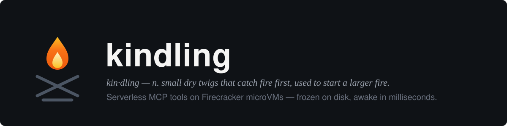

<p align="center">
  
</p>

<p align="center">
  <a href="https://github.com/juan52878911/kindling/releases"></a>
  <a href="https://github.com/juan52878911/kindling/actions/workflows/ci.yml"></a>
  <a href="LICENSE"></a>
</p>

<p align="center"><b>English</b> · <a href="README.es.md">Español</a></p>

# kindling

**Self-hosted sandboxes for AI agents, where every sandbox is a real microVM: created in
about a millisecond from a warm pool, under 100 ms cold, and costing no CPU or RAM while
frozen. Existing OpenSandbox SDK code points at it by changing the URL and the key.**

<!-- TODO(demo): record docs/demo.gif on a KVM host with `vhs docs/demo.tape`, then uncomment:
<p align="center"></p>
-->

- **Your SDK already speaks it.** `kling sbx osb` serves the OpenSandbox 1.2.1 API
  (lifecycle and execd): its SDKs create sandboxes, run commands and code, and move files
  after you change `domain` and `api_key`. 41 of the spec's 90 operations are implemented;
  the rest (credential vault, snapshots, template builds, diagnostics, isolated sessions)
  answer `501` with the reason ([the list](docs/opensandbox.md)). CI drives the shim with the
  real `opensandbox==1.2.1` Python SDK. E2B SDKs via `kling sbx e2b` (see
  [docs/e2b.md](docs/e2b.md) for what is verified).
- **A hypervisor per sandbox, not a shared kernel.** Each sandbox is a Firecracker microVM
  (on a Mac, Apple's Virtualization or Hypervisor framework) with its own kernel; the guest is
  assumed hostile ([`SECURITY.md`](SECURITY.md)). Tenants share the host and the daemon: a
  token is an owner and a quota, not a separate machine.
- **Nothing boots.** A template is built once into a golden snapshot. A sandbox is a restore
  of that snapshot, or an atomic claim of one already running from the pool.
- **Idle costs nothing.** When its TTL runs out a sandbox is frozen to a file on disk (no
  process, 0 CPU, 0 RAM) and wakes on its next request. `pause` keeps its memory; `fork`
  copies a live sandbox, memory and processes included, into N.
- **One daemon on your box.** A Linux host with KVM (amd64 or arm64) or a Mac with Apple
  Silicon. No Kubernetes and no Docker on the host. The daemon listens only on a Unix
  socket; the gateway in front adds tokens, quotas, templates and several hosts.

**Full documentation: [kindling.asccilabs.com](https://kindling.asccilabs.com)** ·
in the repo: [`docs/`](docs/README.md), starting with the [full guide](docs/guide.md).

## Numbers

kindling against OpenSandbox 1.2.1 on the same machine, one system at a time, with the same
client (`scripts/bench/`). Ranges are across 3 rounds.

| measure | kindling | OpenSandbox 1.2.1 |
|---|---|---|
| create from the pool, serial (n=15) | **0.8–1.1 ms** | 34 ms (k8s `Pool`) |
| create cold, serial (n=15) | **76–91 ms** | 0.91–1.11 s (k8s) · 524–543 ms (docker) |
| create cold, 50 concurrent | **p50 603–633 ms, p95 977–1072 ms** | 4.0–4.6 s, 19/50 failed (k8s) · 7.6–7.7 s (docker) |
| exec `echo` through the gateway (n=30) | **1.7–1.9 ms** | not compared: we measured ~1 s and have not found why (OpenSandbox documents ~203 ms) |
| failed creates | **0 in ~1700** | 19/50 (k8s, cold c50) · 25/50 (k8s `Pool`, c50) |

Caveats, in one line: nested virtualization on a single EC2 c8i.2xlarge (8 vCPU), small n,
measured 2026-11-21; microVMs against OpenSandbox's containers (runc) on its Kubernetes (k3s)
and Docker runtimes, **not** against OpenSandbox on Kata or gVisor, which was not measured;
the two "pools" are different things (10 pre-started microVMs vs. a `Pool` CRD of pods); and
OpenSandbox is ahead on a credential vault, diagnostics, native Kubernetes CRDs and more SDKs.
All nine caveats and how to reproduce: [`docs/benchmarks.md`](docs/benchmarks.md#kindling-vs-opensandbox-121).

## From zero to an agent running code

On a Linux host with KVM. The one slow step is building the `toolchain` image, once; after
that, every sandbox comes from a snapshot.

```sh
# kindling, the sandbox extension and the daemon (firecracker, jailer, systemd unit)
curl -fsSL https://raw.githubusercontent.com/juan52878911/kindling/main/scripts/install.sh | sudo sh -s -- --tag v1.0.0-rc.3 --with sandbox
sudo kling up -install
kling image toolchain                    # Node, npm, Python 3 and pip

# a token (a token is a tenant) and the gateway in front of the daemon
export KLING_SANDBOX_TOKEN=$(openssl rand -hex 24)
kling sbx gateway &                      # http://127.0.0.1:8090; plain HTTP only on loopback

# a template: built once into a golden snapshot, with one sandbox kept warm in the pool
curl -fsSL https://raw.githubusercontent.com/juan52878911/kindling/main/examples/sandbox/templates/python.json | kling sbx template apply -f -

kling sbx new -template python -ttl 10m  # prints the id and how long it took
kling sbx exec <id> -- python3 -c 'print(6*7)'
```

**From Python, with kindling's SDK** (standard library only; not on PyPI yet):

```sh
pip install "git+https://github.com/juan52878911/kindling#subdirectory=sdks/python"
```

```python
from kindling_sandbox import Sandbox      # reads KLING_SANDBOX_URL and KLING_SANDBOX_TOKEN

with Sandbox.create(template="python", ttl=600) as sb:     # deleted on exit
    print(sb.exec(["python3", "-c", "print(6*7)"]).stdout)
```

**From code written for OpenSandbox**, unchanged except for the connection:

```sh
pip install opensandbox==1.2.1
kling sbx osb -default-template python & # OpenSandbox API on 127.0.0.1:8080; every image runs on "python"
```

```python
import os
from datetime import timedelta
from opensandbox.config.connection_sync import ConnectionConfigSync
from opensandbox.sync.sandbox import SandboxSync

cfg = ConnectionConfigSync(domain="http://127.0.0.1:8080", api_key=os.environ["KLING_SANDBOX_TOKEN"])
sb = SandboxSync.create("python:3.12", connection_config=cfg, timeout=timedelta(minutes=10))
print(sb.commands.run("python3 -c 'print(6*7)'").logs.stdout[0].text)
sb.kill()
```

OpenSandbox starts containers from an image; kindling starts microVMs from a template, so the
shim maps one to the other (`-image-map python:3.12=python`, repeatable, or
`-default-template`). Also: the TypeScript SDK ([`sdks/typescript`](sdks/typescript/README.md)),
E2B SDKs via `kling sbx e2b` (see [docs/e2b.md](docs/e2b.md) for what is verified), and
`kling sbx mcp`, an MCP server (stdio) that gives an agent the sandboxes as tools.

Next: the [quickstart](docs/quickstart-sandbox.md) explains each step, the
[`/v1` API](docs/sandbox-api.md) has the rest (batches, volumes, fork, code contexts, ports),
and the [examples](examples/sandbox/README.md) include a LangChain tool and forking one
prepared sandbox into variants.

## Install

**Linux with KVM** (amd64 or arm64):

```sh
curl -fsSL https://raw.githubusercontent.com/juan52878911/kindling/main/scripts/install.sh | sudo sh -s -- --tag v1.0.0-rc.3
sudo kling up -install   # firecracker, jailer, the kindling users, the systemd unit; starts it
kling try -- uname -a
```

Run as root, `install.sh` puts `kling` in `/usr/local/bin`, where `sudo` and systemd find it
(as a normal user it ends by printing the `sudo install …` line that does the same).
`sudo kling up -install` downloads `firecracker` and `jailer` (a pinned release, sha256
checked) if they are missing, creates the `kindling` and `kindling-build` system users, writes
the unit and starts it; `kling up -install -dry-run` prints those steps and does nothing. The
first `kling try` downloads the guest kernel and `min` from the release (no checkout needed).
On arm64 (Graviton .metal, Ampere, Raspberry Pi 5 with the 4K kernel), which hosts work and how
to tune them: [`docs/linux-arm64.md`](docs/linux-arm64.md).

The daemon can also run as a systemd service on a remote host, deployed from a checkout:
`make deploy HOST=ssh://user@host`. The CLI then reaches it over SSH
(`kling context add lab ssh://user@host`); the daemon never listens on a network port.

**Mac with Apple Silicon** (macOS 14+, native `vz` backend, no root):

```sh
curl -fsSL https://raw.githubusercontent.com/juan52878911/kindling/main/scripts/install.sh | KLING_VERSION=v1.0.0-rc.3 sh
kling try -- uname -a
```

Nothing else to install (no Homebrew, no `minisign`, no checkout): the first `kling try` starts
the daemon (it offers to install its launchd agent) and downloads the guest kernel and the
`min` image from the release, verified against its `SHA256SUMS` (about 10 MB). `kling up` does
the same step by step and prints what is missing; `kling up -uninstall` removes the agent.
Or with Homebrew, from the [tap](https://github.com/juan52878911/homebrew-kindling) (latest
stable release; `brew services start kling` runs the daemon):

```sh
brew install juan52878911/kindling/kling
```

The script checks the signature of `SHA256SUMS` (with `minisign` if you have it, else
`ssh-keygen -Y verify`; with neither, the `kling` it just downloaded checks it, which it reports
as a self-check, not an independent signature) and every binary against it. It installs to
`~/.local/bin` without sudo and takes `--with mcp,sandbox`, `--tag` and `--prefix DIR`. To
upgrade later: `kling upgrade` (`sudo` on Linux; `brew upgrade kling` if Homebrew installed
it) swaps the binaries, restarts the daemon, checks it and rolls back by itself if it fails.
From source: `make install` (plus `make vz` on a Mac). Details: [`docs/mac.md`](docs/mac.md),
[`docs/releases.md`](docs/releases.md), [`docs/actualizar.md`](docs/actualizar.md) (upgrades).

## The core, without the gateway

```sh
kling try -- uname -a        # throwaway microVM: create, run, print, delete
kling run -name demo         # boot a machine
kling freeze demo            # freeze it to disk: 0 CPU, 0 RAM
kling thaw demo              # back in tens of milliseconds

kling image import postgres:17-alpine -e POSTGRES_PASSWORD   # a Docker image, pinned by digest
kling run -image postgres-17-alpine -mem 512M -wait-ready     # its ENTRYPOINT, supervised
```

Docker images run as they are, each as its own base: [`docs/imagenes.md`](docs/imagenes.md).
`kling doctor` checks the daemon, versions and extensions and gives the fix for every failure;
`kling help <command>` shows one command's help.

## Also in the box

- **`kling mcp`** — any MCP server (npm or PyPI) as a service that wakes on demand from a
  golden snapshot, behind one gateway for your agent. [`ext/mcp`](ext/mcp/README.md)
- **`kling db`** — a disposable Postgres (also MySQL, Redis, SQLite) per test or agent, copied
  from a warm template in milliseconds. [`docs/db.md`](docs/db.md)
- **`kling phone`** — Android phones (Redroid) in microVMs, each with its own identity, a
  screen wall and an MCP server. [`ext/phone`](ext/phone/README.md)
- **`kling ai`** — an AI gateway: Chispa, a ~1 MB linear classifier that answers in
  microseconds inside the gateway, escalating to small LLMs in microVMs that freeze when idle.
  [`docs/ai-gateway.md`](docs/ai-gateway.md)
- **`kling graph`** — several machines with declared edges (who may reach whom), frozen,
  snapshotted and forked as one. [`docs/grafos.md`](docs/grafos.md)
- **Home automation demo** — that cascade deciding what a room does with a voice command.
  [`docs/domotica.md`](docs/domotica.md)
- **Kubernetes operator** — ask for sandboxes with `kubectl apply`.
  [`docs/kubernetes.md`](docs/kubernetes.md)

The extensions (`mcp`, `sandbox`, `db`, `phone`) install with `kling plugin install <name>`;
every binary in a release is compatible with every other. Writing your own:
[`docs/extensions.md`](docs/extensions.md). Running Claude Code, Codex CLI or Playwright inside
a sandbox with the API key kept off the VM: [`docs/recetas/`](docs/recetas/README.md).

## Compatibility

kindling 1.x makes a stability promise. The core (`kling`, the daemon, `kling-guest`,
`kling-vz`), the daemon API, the CLI (commands, flags, `-json` output and exit codes), the Go
packages `pkg/api`, `pkg/plugin` and `pkg/config`, the published kernel and `min` images,
and the `mcp` and `sandbox` extensions follow SemVer:
nothing stable breaks within 1.x, anything removed is deprecated first for at least two
minor releases or six months, and `kling upgrade` moves from one release to the next and
back. Templates and frozen machines are a cache: when the host can no longer restore one it
is reported stale and refrozen, not migrated. `db`, `phone`, `ai`, Android, the Kubernetes
operator and `compose` stay experimental; `kling-hv` is stable, with its
macOS e2e run by hand on Apple Silicon before every release until CI has a runner. The full promise:
[`docs/compatibilidad.md`](docs/compatibilidad.md) (in Spanish).

## More

- [`SECURITY.md`](SECURITY.md) — the guest is assumed hostile: threat model, barriers
  and what is not solved yet.
- [`CHANGELOG.md`](CHANGELOG.md) — what each version brought.
- [`docs/benchmarks.md`](docs/benchmarks.md) — every measured number and its hardware.
- [`docs/api.md`](docs/api.md) — the daemon API, for talking to it from another program.

Apache-2.0 — see [`LICENSE`](LICENSE) and [`NOTICE`](NOTICE).
